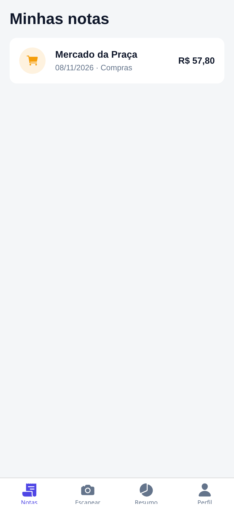
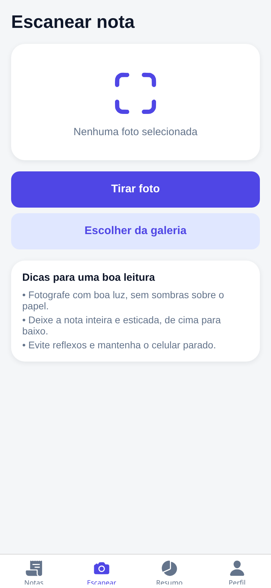
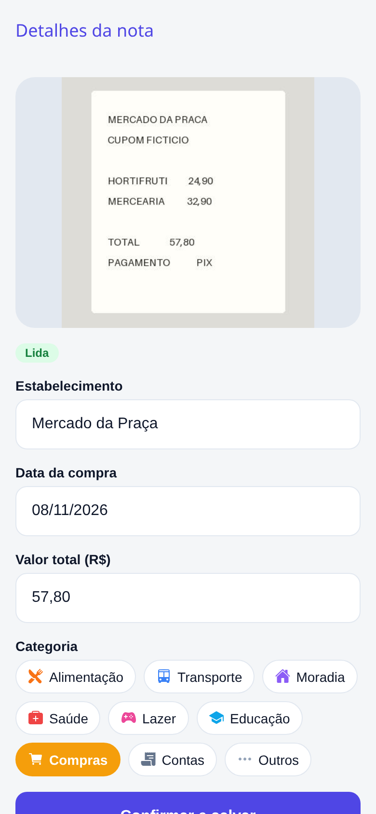
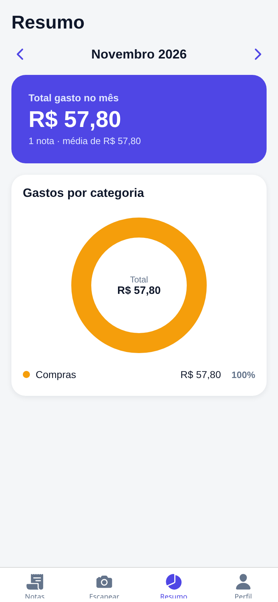

# ScanIA

Aplicativo mobile que lê notas fiscais com inteligência artificial: fotografe o
cupom, e o app extrai estabelecimento, data, valor, categoria e itens. Você revisa,
corrige e acompanha seus gastos por categoria.

## Funcionalidades

- Cadastro, login e sessão persistente (Supabase Auth)
- Captura por câmera ou galeria, com redução da imagem antes do envio
- Leitura da nota por IA em uma Edge Function (a chave da IA nunca vai para o app)
- Revisão e correção dos dados extraídos (humano no circuito)
- Resumo mensal com gráfico por categoria
- Fotos em Storage privado, com acesso restrito ao dono (RLS)

## Tecnologias

React Native · Expo · Expo Router · TypeScript · Supabase (Auth, Postgres, Storage,
Edge Functions) · Claude API (visão) · TanStack Query · React Hook Form · Zod · Jest

## Capturas de tela

As telas abaixo usam uma nota fictícia e foram capturadas no navegador em formato mobile.

| Notas | Escanear | Detalhes | Resumo |
| --- | --- | --- | --- |
|  |  |  |  |

## Como executar

1. Com Node.js 22.13 ou superior, instale as dependências: `npm ci`
2. Crie um projeto no [Supabase](https://supabase.com) e execute `supabase/schema.sql`.
3. Copie `.env.example` para `.env` e preencha a URL e a chave pública.
4. Publique a função e configure os segredos:

   ```
   npx supabase login
   npx supabase init
   npx supabase link --project-ref SEU-PROJECT-REF
   npx supabase secrets set MOCK_AI=true
   npx supabase functions deploy scan-receipt --no-verify-jwt
   ```

   A função valida o token com o Supabase Auth e usa as políticas RLS do usuário.
   Para usar o Claude, configure `ANTHROPIC_API_KEY` como segredo do servidor e defina
   `MOCK_AI=false`. Use uma nota fictícia ao avaliar a integração.
5. Inicie o app: `npx expo start` e abra no Expo Go.

## Arquitetura

```
app/         rotas (Expo Router)
src/         componentes, hooks, serviços, schemas e utilitários
supabase/
  schema.sql             tabelas, RLS e bucket privado
  functions/scan-receipt Edge Function (Deno) que chama a IA
__tests__/   testes unitários (Jest)
```

## Scripts

| Comando             | O que faz                   |
| ------------------- | --------------------------- |
| `npm start`         | Inicia o servidor do Expo   |
| `npm test`          | Executa os testes           |
| `npm run typecheck` | Verifica os tipos           |
| `npm run format`    | Formata o código (Prettier) |

## Validação

`npm test -- --runInBand` executa os 36 testes de valores, datas, despesas e validação da IA.
Para conferir o fluxo no celular, entre com uma conta, escaneie uma nota de exemplo, revise
os campos, consulte o resumo e exclua a nota. Em modo simulado, a função devolve os
mesmos dados de exemplo para cada imagem válida.

## Autor

[vinivini26](https://github.com/vinivini26)

Projeto desenvolvido a partir do guia ScanIA do Prof. Me. Bruno Assunção Dias (IESB).
